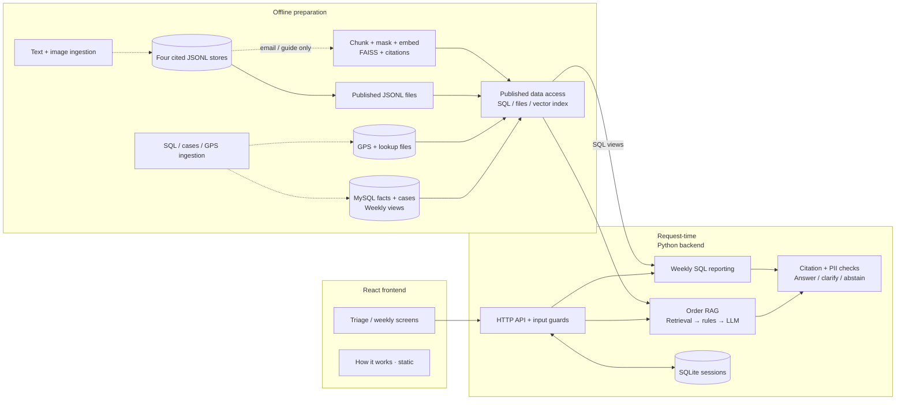

# Architecture proposal — ingestion, embeddings and RAG

- **Reviewed:** 17 Nov 2026 (SGT).
- **Status:** proposed integration; implemented components are identified below.

## 1. Tech stack and executive summary

The first release combines MySQL operational/case data with cited JSONL evidence and a local semantic index. A Python HTTP API serves complaint triage and SQL-based weekly reporting to React screens; order RAG combines exact tools, keyword/category search and semantic retrieval before applying code-based rules and generating a cited answer or abstention.

Preparation runs offline; requests query the published data without repeating ingestion or image extraction. The proposed SQLite store preserves session state across restarts. The assistant recommends actions only; it does not execute refunds, message customers or modify orders.

| Layer | Technology / role | Release status |
|---|---|---|
| Frontend | React 19, JavaScript, Vite 8; HTTP/JSON client | Screens implemented in mock mode; live API integration pending. |
| API and services | Python HTTP API; order RAG, weekly reporting and validation | Proposed; HTTP framework not yet selected. |
| Structured data | MySQL 8 via Docker Compose; SQL facts, canonical complaints and reporting views | Source import documented; application DDL/loaders pending. |
| Evidence preparation | Python standard-library parsers, native XLSX reader, cached vision extraction; JSONL + source manifests | Text/image ingestion and file-backed tools implemented. |
| Retrieval | Exact/keyword/category tools; masked text embeddings and local FAISS index | Lexical tools implemented; embedding capability/model and semantic integration pending. |
| Models | Class-provided endpoint for vision, answer generation and supported embeddings | Cached vision calls implemented; answer/embedding integration pending. |
| Sessions and telemetry | Local SQLite sessions; request/tool traces, latency, token and spend records | Sessions and shared request tracing pending; extraction telemetry exists. |

Detailed release design: [editable SVG](./merlion-express-technical-architecture_v1.drawio.svg) · [draw.io source](./merlion-express-technical-architecture_v1.drawio).

## 2. Standalone modules

Each preparation module runs independently of HTTP requests. Paths marked **proposed** describe new modules, not existing commands.

| Module | Input → output | Status |
|---|---|---|
| `backend.structured.bootstrap` | Initial SQL dump → `merlion_express`; apply versioned application DDL/views | Proposed; manual import exists. |
| `backend.structured.case_ingest` | Workbook **Case Log** → lossless `raw_case_log` | Proposed. |
| `backend.structured.case_transform` | Raw cases + operational facts → canonical cases, member lineage and weekly views | Proposed; preserve duplicates before reviewed deduplication. |
| `backend.structured.gps_ingest` | GPS JSONL → validated driver/time index, initially file-backed | Proposed; retain epoch/source lines and verify clock alignment. |
| `backend.structured.reference_seed` | Reviewed town/zone mappings and sourced SG calendar → versioned lookup files | Proposed; distinguish operations zones from price zones. |
| `backend.unstructured.ingest` | Emails + workbook **Resolution Guide** → `emails.jsonl`, `policy_chunks.jsonl`, manifest | Implemented: `emails.py`, `policy.py`, `xlsx.py`. |
| `backend.unstructured.extract_images` | POD/rate images → `pod_records.jsonl`, `rate_cards.jsonl`, image manifest | Implemented: vision extraction, cache and SQL-dump validation. |
| `backend.rag.index` | Masked email/guide chunks → embeddings, local FAISS index and citation metadata | Proposed; embedding-endpoint capability check pending. |
| `backend.rag.retrieve` | Query → exact/keyword/vector hits plus SQL, GPS, POD and rate evidence | Proposed integration; existing file-backed tools available. |
| `backend.rag.answer` | Evidence + deterministic policy/rate checks → checked answer, citations and saved session | Proposed. |
| `backend.api` / reporting service | Validated HTTP requests → triage/session responses or SQL-derived weekly summaries | Proposed; frontend client defines draft routes. |

**Setup order:** bootstrap → reference seeds → case ingest/transform + GPS preparation + text/image ingestion → embedding index → validate/publish one batch. Preserve hashes and rule/model versions; identical inputs reuse outputs, and later SQL dumps enter staging instead of overwriting application tables.

## 3. Database: current and final design

Keep one MySQL database, `merlion_express`. The source dump creates/seeds the three instructor tables; the remaining objects below are design targets, not verified live tables.

| State | Tables / storage |
|---|---|
| Available source schema | `drivers`, `orders`, `deliveries`; expected seed counts: 40 / 25,833 / 24,802. Preserve them unchanged. |
| Immediate delivery — pending | Add `raw_case_log`, `clean_cases`, `clean_case_members`; create `view_weekly_complaints_by_driver` and `view_weekly_complaints_by_zone`. |
| Future operational tables | `clean_drivers`, `clean_orders`, `clean_deliveries_latest`, `clean_gps_pings`, `clean_zone_mapping`, `clean_calendar_dates`. |
| Future evidence tables | `clean_complaint_emails`, `clean_pod_evidence`, `clean_policy_rules`, `clean_rate_cards`, `clean_rate_prices`, `clean_rate_surcharges`. |
| Future metadata tables | `meta_source_documents`, `meta_ingestion_runs`; import existing file-manifest lineage. |
| RAG/session stores — proposed | Versioned FAISS index + chunk metadata outside MySQL; local SQLite session store for restart recovery. SQL chunk/session tables remain optional. |

Order identity is `(system_version, order_id)`; raw `orders` has no declared primary key. The case relationship is `raw_case_log` → `clean_case_members` → `clean_cases`: preserve all 505 source rows, then map them to reviewed canonical complaints.

The fuller SQL design has **3 instructor + 17 application tables**; 14 application tables remain future enhancements. The demo keeps POD, rate, email and policy evidence in JSONL. See the [database inventory](database-design_2026-11-16.md#3-complete-proposed-data-table-inventory) for the optional expansion.

## 4. Compact release flow

This is the proposed integrated system. Text/image ingestion and file-backed retrieval exist; structured preparation, embeddings, HTTP services and answer generation remain pending.

Solid arrows show request-time dependencies; dashed arrows show offline preparation. The API returns validated JSON to the calling screen; the static explainer makes no API calls.

**Indexing:** reuse guide rows and source-bounded email chunks; retain original locators alongside masked text. Cache vectors by source/chunk hash, masking/chunker version and embedding model/dimension; publish the index with its matching SQL/file batch.

**Query:** resolve order candidates with parameterised SQL; ask for clarification if ambiguous. Embed the masked question with the same model, combine top-k semantic hits with existing keyword/category tools, and filter by the resolved order/source version where applicable.

**Answer:** combine cited text with exact SQL/POD/GPS/rate results; calculate charges and enforce guide limits in code. Send only the necessary masked context to the answer model, validate claim support and citations, then persist and return the result; missing/conflicting evidence stays explicit.

Embeddings retrieve relevant text; SQL and code establish identities, joins and calculations. Evaluate hybrid retrieval against the lexical baseline before enabling it by default.

## 5. Frontend screens and API calls

These paths match [`frontend/src/api/client.js`](../../frontend/src/api/client.js); backend implementation and contract agreement are pending.

| Screen | Calls | Displays |
|---|---|---|
| Complaint triage — `#/triage` | `POST /api/complaints` (`email_text`, optional `session_id`); `POST /api/sessions/{id}/messages` (`message` / `selected_candidate`); `GET /api/sessions/{id}` | Complaint form, candidate clarification, evidence/conflicts, recommendation or abstention, citations, follow-up and recovery. |
| Weekly analysis — `#/weekly` | `GET /api/weekly/weeks`; `GET /api/weekly?week_start=YYYY-MM-DD` | Counts, drivers/zones, trends, guide gaps, duplicates and unknown attribution; sourced from canonical-case SQL, not vector search. |
| How it works — `#/how-it-works` | None; static content | Flow, guardrails and limitations; align wording with verified backend behaviour. |

`/api/health` is declared in the client route map but currently has no screen caller. The browser stores the last session ID; server persistence must store the actual state. Real API mode requires `VITE_USE_MOCK=false` and a nonempty `VITE_API_BASE_URL`.

## 6. Client rules and release checks

Apply [client clarifications Q01–Q08](../00-Biz_Requirements/client_qa_v02.xlsx): one complaint per case; guide v2 for every date; address-derived operations zones distinct from pricing zones; honest missing-POD/latest-attempt limits; validated GPS alignment. Apply the April card retrospectively, inclusive weight limits and standard service, deriving CBD/holiday inputs and referring unconfirmed attempt charges.

Verify fresh setup/reruns, canonical-case counts, citations, retrieval relevance, source/index consistency, API contracts and session recovery. Acceptance requires at least 20 evals including two refusals, five kill-shot phrasings, dependency-failure handling and request/tool spend traces. The regex masking helper needs additional personal-name coverage before embedding/answer exposure; these checks remain release work, not claimed passes.
