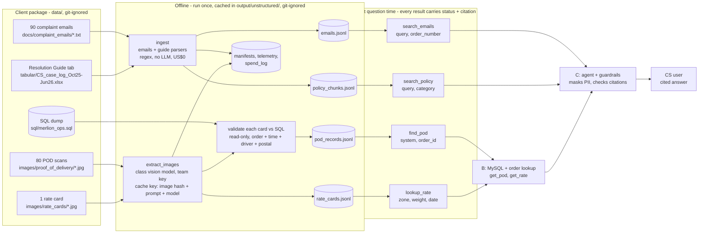

# Release 1 client demo architecture

[Open editable SVG](merlion-express-technical-architecture-codex-20261117-114201.drawio.svg) · [Edit in draw.io](merlion-express-technical-architecture-codex-20261117-114201.drawio)

MySQL holds operational facts, canonical complaints and weekly views; Ralph's evidence stays in JSONL files. Email/guide chunks feed semantic retrieval, while SQL and code resolve identities, calculate charges and enforce policy.

This is the intended release design. Dashed components are pending implementation; React screens currently use mocks. The footer records [client clarifications](../00-Biz_Requirements/client_qa_v02.xlsx) and demo acceptance checks.

Ralph's original unstructured design and Mermaid source

# Architecture

- Cleaned-schema ER diagram and architecture proposal
- Architecture plus Mermaid data flow, cleaned ER and complaint sequence
- C compiles; A/B/D supply their areas

---

## A — Unstructured sources: data flow (Ralph, 17 Nov 2026)

How emails, POD scans, the rate card and the Resolution Guide become cited evidence. Code: `backend/unstructured/`
(standard library only). Record shapes and tool envelopes: `contracts_2026-11-16.md` §1–§6.

| Stage | What happens | Cost | Rerun |
|---|---|---|---|
| ingest | Emails parsed into 7 categories with order numbers and exact `body:char` locators; guide tab parsed into 9 rules + 3 notes cited `sheet:Resolution Guide\|row:n` | US$0 | `python -m backend.unstructured.ingest` |
| extract_images | Vision model copies each card; code sets confidence, fixes look-alikes (flagged), validates against SQL | US$0.32 once (81 images) | `python -m backend.unstructured.extract_images` — cached, so free unless an image, prompt or model changes |
| tools | Read the cached files when C asks; never call the model | US$0 | — |

Where the client's answers (16 Nov) apply: guide v2 applies to every case (Q02) → `search_policy`; no POD after 1 Feb
(Q04) → `find_pod`; April card for all orders (Q06), upper weight limit inclusive (Q07), standard delivery only (Q08),
ops zone → price row (Q03) → `lookup_rate`. Records are unmasked by team decision; C masks before the model or a
customer sees anything.

